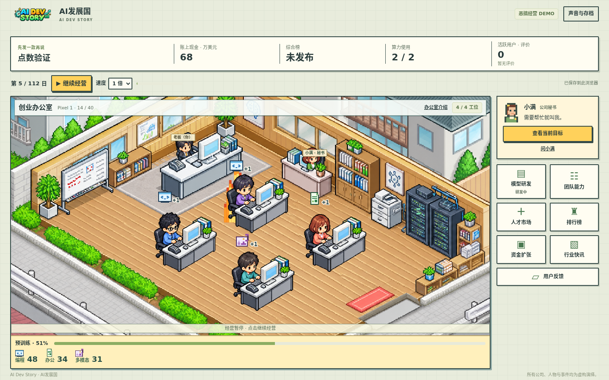

# AI发展国 · AI Dev Story

一款讽刺 AI 公司刷榜、融资和发布新模型的像素风经营游戏 Demo。经营一家初创公司，招聘员工、购买算力、研发模型、冲击排行榜；用户的真实体验也许会成为下一个版本的重点。



**[在线游玩](https://degraw4.github.io/ai-dev-story/)** · 游戏仍在试玩和数值调整中，完整游玩时长尚未验证。

## 开始游戏

需要 Node.js 22 或更新版本。网页运行不需要安装第三方依赖。

```bash
git clone https://github.com/degraw4/ai-dev-story.git
cd ai-dev-story
npm start
```

在浏览器打开 <http://127.0.0.1:4173/>。如果端口被占用，可以运行 `PORT=4174 npm start`，再打开对应端口。如果服务运行在远程机器，请先配置端口转发。网页使用 JavaScript 模块，请通过本地服务打开，不要直接双击 HTML 文件。

## 怎么玩

- 跟随秘书小满熟悉办公室、时间控制和各个管理页面。
- 创建模型项目，选择编程、办公或多模态方向，再选择一名员工设计方案。
- 员工自动完成研发；增加员工和购买算力可以改变研发成果和速度。
- 发布模型，观察榜单、用户和收入的变化；融资、购买媒体报道、招聘和扩张需要权衡资金。
- 经营到结局，或在现金耗尽时结束。进度保存在当前浏览器的本地存储中，同一浏览器不同网址的存档互不共享。

游戏是虚构的讽刺作品，模型和榜单均为游戏机制，不调用真实模型，也没有联网排行榜。

## 开发与验证

```bash
npm test                # 规则、存档和界面相关测试
npm run check:balance   # 经营路线与费用核算
```

`npm run check:audio` 和 `npm run check:sounds` 需要 Python 3 和 NumPy，用于检查已生成的音乐和音效。`npm run check:browser` 需要可连接的 Chromium 调试端口和运行中的游戏服务；浏览器检查会操作该浏览器的本地存储，请使用独立测试配置，不要使用正在游玩的浏览器配置。

- `src/`：游戏规则、内容和界面逻辑
- `assets/`：像素素材、音乐及其来源记录
- `scripts/`、`tests/`：本地服务、核算与自动检查
- `docs/`：设计、决策和验证记录
- `design-preview/`：设计样张；游戏入口是根目录的 `index.html`

目前的已知体验问题包括：中期模型排名提升和订阅收入可能偏慢，招聘压力较大；这些问题仍待继续试玩和调整。

## 许可证与素材

项目代码和项目原创素材以 [MIT License](LICENSE) 发布。生成图片的来源、音乐与音效的制作方式见[素材说明](docs/ASSET_RIGHTS.md)。用户提供的商业游戏截图与视频仅用于本地参考，不包含在仓库中；其他作品的名称和商标不在本项目的许可范围内。游戏角色和事件均为虚构。
